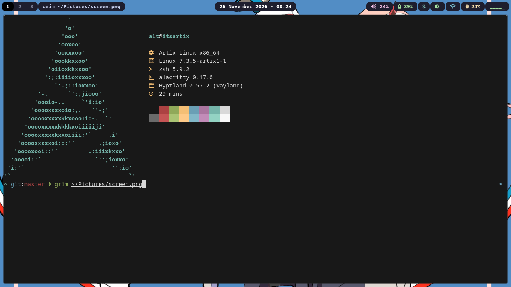

# hyprland-dotfiles

My personal dotfiles for an Artix Linux + Hyprland setup. Themes around a minimal, keyboard-driven Wayland desktop.

## Screenshot


## Components

- **OS:** Artix Linux
- **Compositor:** Hyprland
- **Bar:** Waybar
- **Terminal:** Alacritty
- **Launcher:** Wofi
- **Shell:** zsh (oh-my-zsh)
- **GTK theming:** gtk-3.0 / gtk-4.0 + fontconfig
- **System monitors:** btop, fastfetch

## Installation

> Always review scripts/configs before running them. These are my personal configs — copy selectively rather than blindly replacing your own.

Clone into your home directory:

```bash
git clone https://github.com/nomwnomw/hyprland-dotfiles.git
cd hyprland-dotfiles
```

Then symlink or copy the pieces you want, e.g.:

```bash
ln -s ~/hyprland-dotfiles/.zshrc ~/.zshrc
ln -s ~/hyprland-dotfiles/.config/hypr ~/.config/hypr
ln -s ~/hyprland-dotfiles/.config/waybar ~/.config/waybar
ln -s ~/hyprland-dotfiles/.config/alacritty ~/.config/alacritty
ln -s ~/hyprland-dotfiles/.config/wofi ~/.config/wofi
```

Or use [GNU Stow](https://www.gnu.org/software/stow/) if you prefer:

```bash
stow -t ~ .
```

## Dependencies

Rough list of packages the setup expects (Arch/Artix package names):

```
hyprland waybar alacritty wofi zsh grim slurp wl-clipboard btop fastfetch
```

Adjust to your distro's packaging.


